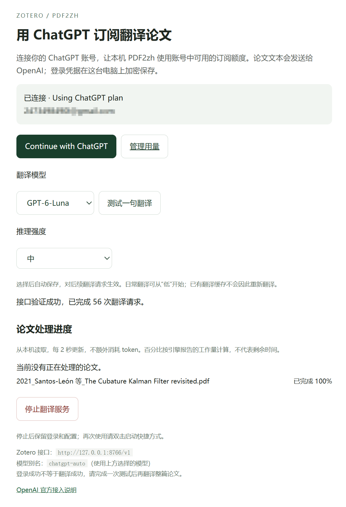

# ChatGPT PDF2zh Bridge

在 Windows 上将 Zotero PDF2zh 与 Sign in with ChatGPT DevKit 连接，生成中文 PDF 和中英对照 PDF。

本仓库发布的是本地桥接服务、启动器以及 SDK 补丁，不包含 PDF2zh 引擎、Zotero 插件或独立 EXE。需要先安装可用的 Zotero PDF2zh 后端。ChatGPT 登录授权、模型目录和可用额度取决于账号。

## 功能

- 本地网页登录、选择模型和推理强度，设置自动保存。
- 安装并启动向导自动检测常见安装路径，生成本机配置和桌面快捷方式。
- 将文本 Chat Completions 请求转换为 SDK Responses 请求。
- 最多 4 路翻译并发，记录服务返回的 token 用量。
- 凭据使用 Windows 当前用户 DPAPI 加密，服务仅监听 127.0.0.1。
- 复用 PDF2zh 的整篇翻译、双语排版和 Zotero 附件回填。
- 一键停止后台服务，保留登录和配置；有 PDF 任务运行时拒绝停止。
- 网页显示论文总体进度，以及正文翻译、排版、字体处理和保存等阶段的百分比。
- 支持普通翻译、双语对照、裁剪和裁剪对照入口的任务状态与完成记录；裁剪等未报告细分百分比的操作显示阶段名称。

## 界面预览



## 安装

需要 Windows、[Node.js](https://nodejs.org/) 22.12 或更高版本（含 npm），以及已经能正常运行的 Zotero PDF2zh 后端及其 Python/Conda 环境。安装时需要联网下载 SDK 和依赖。此安装器配置的是 **ChatGPT 桥接组件**，不会安装 Zotero 插件、PDF2zh 引擎或修复尚未安装好的翻译环境。当前启动器按 Conda 后端配置运行，其他环境管理方式未验证。

### 推荐：安装并启动

1. 在 GitHub 点 **Code → Download ZIP**，完整解压到自己选定的文件夹；不要直接在压缩包内运行，建议避开 AppData、Program Files 和云同步目录。
2. 双击 **`安装并启动.vbs`**。安装过程中会显示进度窗口。
3. 程序自动查找 Node.js、后端 Python 和 `server.py` 文件夹；检测到唯一位置时直接使用，不需要手动编辑路径。没有找到或有多个候选时，会弹出文件选择框，按下方说明选择。
4. 缺少 Node.js 时，如果电脑有 `winget`，程序会询问是否安装；输入 `y` 同意后安装。若不可用，请先自行安装 [Node.js](https://nodejs.org/)（至少 22.12，含 npm），再重试。
5. 安装器下载固定版本 SDK 压缩包，校验文件后应用补丁并构建，生成本机 `config.local.ps1`，创建桌面的 **ChatGPT PDF Translation** 和 **Stop ChatGPT PDF Translation** 快捷方式，然后打开连接网页。首次仍需自己登录 ChatGPT，并完成下方 Zotero 设置。

自动检测覆盖 PATH、常见安装目录、Conda 记录的 `zotero-pdf2zh-server` 环境和常见后端目录；自定义目录可能需要选择一次。重复运行会保留已有配置和登录，已应用的 SDK 补丁不会重复应用。已有 SDK 源文件与固定版本及补丁不一致时会停止，不会删除或重置源码。下载或构建因网络失败时，按窗口提示处理后重试。

以后日常使用只需双击桌面的启动快捷方式，**不必每次重新安装**。要只查看自动检测结果，可在项目目录运行：

```powershell
powershell -NoProfile -ExecutionPolicy Bypass -File .\install.ps1 -CheckOnly
```

### 手动配置：三个路径怎么找

如果希望手动填写，先把项目中的 `config.example.ps1` **复制一份**，重命名为 `config.local.ps1`，用记事本打开。已有 `config.local.ps1` 时直接编辑，不要用模板覆盖。

| 变量 | 填什么 | 怎么找到 |
| --- | --- | --- |
| `$NodePath` | `node.exe` 的完整文件路径 | 在 PowerShell 中运行 `where.exe node`；常见结果为 `C:\Program Files\nodejs\node.exe`。没有结果时，查看 Node 安装目录或先安装 Node。 |
| `$PythonPath` | **运行 PDF2zh 后端的环境**中的 `python.exe` | 运行 `conda env list` 找到后端环境的位置，通常名称为 `zotero-pdf2zh-server`，再在环境目录中找到 `python.exe`。也可以在已激活后端环境的终端运行下方命令。不要随意选系统 Python 或只装了翻译引擎的环境。 |
| `$BackendPath` | 包含 `server.py` 的**文件夹** | 找到原来安装的 Zotero PDF2zh 后端，通常是 `zotero-pdf2zh\server`，里面应同时有 `server.py`、`utils` 和 `config`。也可以用记事本查看原后端启动脚本中的目录。此项不能填 `server.py` 文件本身。 |

在原本运行 PDF2zh 后端的 Python 环境中查询解释器路径：

```powershell
python -c "import sys; print(sys.executable)"
```

如果后端 Conda 环境名称正好是 `zotero-pdf2zh-server`，也可以直接运行：

```powershell
conda run -n zotero-pdf2zh-server python -c "import sys; print(sys.executable)"
```

填写示例（目录仅作示例，请替换为自己电脑的实际路径）：

```powershell
$NodePath = 'C:\Program Files\nodejs\node.exe'
$PythonPath = 'C:\Users\YourName\miniconda3\envs\zotero-pdf2zh-server\python.exe'
$BackendPath = 'D:\Tools\zotero-pdf2zh\server'
$DataDir = Join-Path $PSScriptRoot '.local-data'
```

保留英文单引号，路径含空格也可以；Windows 反斜杠不需要重复。资源管理器的“复制文件地址”可能带双引号，粘贴到单引号之间前应去掉那一对双引号。路径含中文时，将配置保存为 **UTF-8 with BOM**（或记事本的“带 BOM 的 UTF-8”），兼容 Windows PowerShell 5.1。

`$DataDir` 是数据目录，保持默认即可，不算需要查找的安装路径。它会使用项目下的 `.local-data`，保存登录、密钥、设置与日志。若改成其他目录，应使用 AppData 和云同步目录之外的绝对路径，并避免提交到 Git。

保存后，双击 `安装并启动.vbs` 会读取并验证配置；也可以在 Node/npm 已可用的 PowerShell 中依次执行：

```powershell
powershell -NoProfile -ExecutionPolicy Bypass -File .\setup.ps1
powershell -NoProfile -ExecutionPolicy Bypass -File .\start.ps1
```

安装器会检查选定的 Python 能否加载后端模块。若提示缺少依赖，请选回原来能启动后端的 Python 环境。已测试的后端组合为 Zotero 10、PDF2zh 插件 4.1.7、后端 4.0.4、pdf2zh_next；其他版本兼容性未验证。

## 使用

1. 双击 `启动ChatGPT翻译.vbs`，或执行 `powershell -NoProfile -ExecutionPolicy Bypass -File .\start.ps1`。打开 <http://127.0.0.1:8766/>。
2. 点击 Continue with ChatGPT，在官方页面完成授权，回到本机页面选择账号实际可用的模型与推理强度。测试按钮会发送一次真实请求并消耗额度。
3. 在 Zotero PDF2zh 设置中填写下表。首次启动会自动生成本机连接密钥，请在本机 PowerShell 中读取后粘贴到插件，不要发到公开网页或 issue：

```powershell
$DataDir = Join-Path $PWD '.local-data'
. .\config.local.ps1
(Get-Content (Join-Path $DataDir 'bridge.json') -Raw | ConvertFrom-Json).apiKey
```

| 配置项 | 值 |
| --- | --- |
| Python 服务器 | `http://127.0.0.1:8767` |
| 翻译引擎 | `pdf2zh_next` |
| 服务 | OpenAI / `openai` |
| 模型 | `chatgpt-auto` |
| API URL | `http://127.0.0.1:8766/v1` |
| API Key | 上述本机连接密钥（不是 OpenAI Platform API Key） |
| Worker / QPS | `4` / `2` |
| JSON mode | 关闭 |

4. 在 Zotero 中右键 PDF，使用 PDF2zh 翻译。关闭网页不会停止后台服务，电脑重启后需再次启动。VBS 隐藏运行；若启动失败，用 PowerShell 执行 start.ps1 查看错误。

### 停止服务

不用时点击连接网页中的 **停止翻译服务**。成功后页面显示“服务已停止”，并停止轮询；再次使用请双击启动快捷方式，再刷新网页。也可以双击 `停止ChatGPT翻译.vbs`，或在项目目录执行：

```powershell
powershell -NoProfile -ExecutionPolicy Bypass -File .\stop.ps1
```

停止器核对 PID、端口和程序身份，只请求关闭这套 Node/Python 服务，不会批量结束其他程序。若正在登录、翻译或处理 PDF，请等待完成再停止。停止后登录、密钥和设置仍保留；再次双击启动入口即可使用。可以右键 VBS 创建桌面快捷方式。
## 用量与限制

- 网页每 2 秒读取一次本地进度，不调用模型，不额外消耗 token。进度来自 pdf2zh_next 引擎的结构化事件，适用于通过后端 Python/虚拟环境运行的方式；其他引擎或独立 EXE 没有报告准确进度时，页面显示等待上报或阶段名称。
- 总体百分比是引擎估算的工作量进度，不是剩余时间。阶段百分比独立计算；分批处理时会标明当前部分，最终文件生成成功后才显示总体 100%。
- 数据保存在 `config.local.ps1` 的 `$DataDir`。`account` 为加密凭据，`bridge.json` 包含本机密钥，`usage.jsonl` 记录数值用量。
- 启动器通过 `ZOTERO_CHATGPT_DATA_DIR` 将同一个绝对路径传给服务，日志与 PID 也写在此处。直接运行 `node server.mjs` 时，需自行设置此变量，否则使用该代码目录下的 `.local-data`。`GET /status` 的 `dataDir` 可核对实际路径。
- `/status` 的统计从本次启动起累计。token 数不等同于订阅额度百分比；账号额度还可能被其他会话消耗。用量与授权可在 <https://chatgpt.com/settings/usage> 管理。
- 默认首次配置是 GPT-6.1 Sol / 默认强度；可在网页中改为账号可用的其他模型。账号没有该模型时请选择目录中的模型。设置只影响后续请求，翻译期间请勿切换。
- `chatgpt-auto` 是固定别名：切换实际模型或强度后，PDF2zh 可能复用旧缓存。严格对比时需要在后端启用 `ignore_cache`；正常使用后可恢复缓存。
- 主翻译与回退任务可能同时触发本机 4 路上限，返回 429 后由翻译器重试。
- 排版由 PDF2zh 处理，复杂图注、表头、参考文献可能出现断字或重叠。此桥接器不修复排版。
- 仅支持非流式的文本 Chat Completions 输入，不是通用 OpenAI API 代理。SDK 在上游仍使用流式响应。

## 离线测试

完成安装后运行以下命令。测试使用模拟响应，不发送真实翻译请求：

```powershell
node --test adapter.test.mjs data-dir.test.mjs sdk-archive.test.mjs vendor/sign-in-with-chatgpt-devkit/packages/local/test/responses.test.mjs
powershell -NoProfile -ExecutionPolicy Bypass -File .\install-paths.test.ps1
```

后端停止保护的测试使用配置中的 Python 环境（需 Flask）：

```powershell
. .\config.local.ps1
& $PythonPath .\backend_control_test.py
& $PythonPath .\progress_capture_test.py
& $PythonPath .\route_tasks_test.py
```

## 上游与许可

SDK 来源：<https://github.com/openai/sign-in-with-chatgpt-devkit>，固定提交 `0a36fefeb913055c8c7a1a29b63d82b96b2e841a`。

SDK 补丁保留 `response.completed` 的 usage 数据，并添加 reasoning effort 参数及对应测试。修改文件内包含变更声明。SDK 及这些修改受 [Sign-in with ChatGPT DevKit Noncommercial License](patches/SDK-LICENSE.txt) 约束，仅限该许可定义的非商业用途；不能将整套项目当作不受限制的 MIT 软件。上游依赖的许可见其仓库。

Zotero PDF2zh 上游：<https://github.com/guaguastandup/zotero-pdf2zh>。
